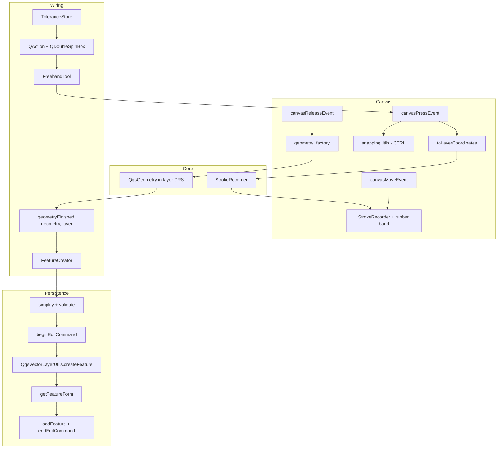

# Freehand Digitize — Architecture

> Version 2.0.0 | Last Updated: 2026-11-19
>
> Technical architecture of the plugin. For the upstream comparison see
> [FEATURE_PARITY.md](maintainer/FEATURE_PARITY.md); for the approved plan see
> [PLAN_FREEHAND_PARITY.md](maintainer/PLAN_FREEHAND_PARITY.md).

## 📑 Table of contents

1. [Overview](#-overview)
2. [Directory structure](#-directory-structure)
3. [System architecture](#-system-architecture)
4. [Core layer](#-core-layer)
5. [GUI layer](#-gui-layer)
6. [Plugin wiring and lifecycle](#-plugin-wiring-and-lifecycle)
7. [Data flow](#-data-flow)
8. [Design principles](#-design-principles)
9. [Error handling and logging](#-error-handling-and-logging)
10. [Testing](#-testing)
11. [Quality and packaging](#-quality-and-packaging)
12. [Extensibility](#-extensibility)
13. [Known limitations](#-known-limitations)
14. [Related documents](#-related-documents)

---

## 🎯 Overview

Freehand Digitize is a QGIS plugin that draws lines and polygons freehand on the
active vector layer. It is a modernized derivative of the classic
[`freehandEditing`](https://github.com/vinayan/freehandEditing) plugin, targeting
**QGIS 3.28–4.x** on **Qt5 and Qt6** with no external Python dependencies.

### Key features

- Freehand line/polygon digitizing with a pencil cursor and a live rubber band.
- Configurable, persisted simplification tolerance (0–5 layer units).
- Geographic-CRS policy (tolerance forced to 0).
- CTRL snapping of the first and last vertex through the QGIS snapping engine.
- Strokes stored in **layer coordinates** (on-the-fly reprojection safe).
- QGIS attribute form, provider defaults and a single undo command per feature.
- Invalid-geometry confirmation instead of silent `makeValid()`.
- Action enabled only for editable line/polygon layers.
- Qt5/Qt6 compatibility isolated in a single shim module.

---

## 📂 Directory structure

```
freehand_digitize/
├── __init__.py                  # classFactory (QGIS entry point)
├── freehand_plugin.py           # action, spinbox, signals, lifecycle
├── core/                        # pure Python, no QGIS/Qt
│   ├── constants.py             # keys, limits, user-facing texts
│   ├── geometry_rules.py        # kinds, tolerance, ring closure
│   ├── settings.py              # ToleranceStore + form preference
│   └── stroke.py                # StrokeRecorder (pixel sampling)
├── gui/                         # PyQGIS/Qt
│   ├── cursor.py                # pencil XPM
│   ├── feature_creator.py       # simplify/validate/form/defaults/undo
│   ├── freehand_tool.py         # QgsMapTool, snapping, rubber band
│   ├── geometry_factory.py      # stroke points -> QgsGeometry
│   └── qt_compat.py             # PyQt5/PyQt6 + QGIS enum shims
├── tests/
│   ├── core/                    # QGIS-free unit tests
│   ├── integration/             # real QGIS tests (skip without qgis)
│   └── mocks/                   # settings fake
├── docs/                        # architecture, maintainer guides, logs
└── .agent/ + .agent-state/      # Agentic Forge framework + project state
```

---

## 🏗️ System architecture



The canvas layer records geometry; the core layer makes pure decisions; the
wiring layer owns the action, tolerance and signals; the persistence layer
creates the feature. No component blocks the UI with background work.

---

## ⚙️ Core layer

`core/` must remain importable in a plain Python environment (no QGIS, no Qt).
The unit suite proves this.

### `constants.py`

Centralizes:

- plugin identity (`PLUGIN_NAME`, `PLUGIN_ID`, `LOG_TAG`);
- settings keys (`freehand_digitize/tolerance`, legacy
  `freehandEdit/tolerance`, QGIS form preference);
- tolerance bounds (0–5, 3 decimals, step 0.1);
- stroke limits (`MIN_SAMPLE_PIXELS`, `MAX_STROKE_POINTS`);
- minimum vertex counts and the edit-command text;
- Spanish user-facing strings and tooltips.

### `geometry_rules.py`

Pure functions used by the GUI:

| Function | Responsibility |
| :--- | :--- |
| `geometry_kind(value)` | Map QGIS geometry type values to `point`/`line`/`polygon`/`unknown`. |
| `is_supported_geometry(value)` | Only line and polygon are drawable. |
| `has_enough_points(points, kind)` | 2 points for a line, 3 for a polygon. |
| `clamp_tolerance(value)` | Clamp to `[0, 5]`; `NaN`/infinite/non-numeric → 0. |
| `effective_tolerance(value, geographic)` | Geographic CRS forces 0. |
| `close_ring(points)` | Repeat the first vertex; already-closed rings are untouched. |
| `to_xy(points)` | Normalize tuples or `QgsPointXY`-like objects. |

### `stroke.py`

`StrokeRecorder` is a dataclass that stores the stroke in **layer coordinates**
and thins vertices by **device-pixel distance**:

- `start(layer_point, device_point)` resets and records the first vertex;
- `add(...)` returns `False` for points closer than `min_distance_px` or after
  `max_points`;
- `points` returns a copy; `reset()` clears the stroke.

Pixel-based thinning is CRS-independent. The 1.0.0 implementation compared
layer distances with `mapUnitsPerPixel`, which is wrong when the layer CRS
differs from the project CRS.

### `settings.py`

`ToleranceStore` wraps a `SettingsBackend` protocol (`contains`, `value`,
`setValue`):

- `load()` reads `freehand_digitize/tolerance`; if absent, it reads the legacy
  key and copies it to the new key;
- `save()` clamps before writing;
- `show_attribute_form()` reads the QGIS
  `qgis/digitizing/disable_enter_attribute_values_dialog` preference (default:
  show the form).

`QgsSettings` is injected from the plugin; tests use `FakeSettings`.

---

## 🖥️ GUI layer

### `qt_compat.py`

Single place for version differences:

- `QAction` from `QtGui` (PyQt6) with a `QtWidgets` fallback (PyQt5);
- `Qt.MouseButton`/`Qt.Key`/`Qt.CursorShape` with flat fallbacks;
- `Qgis.GeometryType` and `QgsPointLocator.Type` with `getattr` fallbacks for
  QGIS 3.28;
- `SNAP_VERTEX`, `RUBBERBAND_LINE`, `RUBBERBAND_POLYGON`.

The fallbacks use `getattr` so the QGIS portal's static Qt6 checker does not
report dead flat-enum access.

### `cursor.py`

Builds a 16×16 XPM pencil cursor with hotspot `(8, 8)`, falling back to
`CrossCursor` if the pixmap cannot be created.

### `geometry_factory.py`

Builds a `QgsGeometry` from stroke points:

- line → `fromPolylineXY` (at least 2 points);
- polygon → `close_ring` + `fromPolygonXY` (at least 4 ring points, i.e. 3
  distinct vertices).

### `freehand_tool.py`

`FreehandTool(QgsMapTool)` owns the interaction:

- emits `geometryFinished(QgsGeometry, QgsVectorLayer)`;
- captures the layer on press and finishes the feature there even if the active
  layer changes mid-stroke;
- converts every point with `toLayerCoordinates`;
- snaps the start and release points when CTRL is held
  (`snapToCurrentLayer`, then `snapToMap`, then free point);
- draws a polygon/line rubber band in canvas coordinates;
- ignores presses while drawing and during a modal form (`setIgnoreClick`);
- finishes on **any** button release (upstream secondary-click semantics);
- `Esc` cancels the stroke; a second `Esc` deactivates the tool;
- `cancel_stroke()` clears points and the rubber band;
- `deactivate()` cancels and calls the base implementation.

### `feature_creator.py`

`FeatureCreator` owns insertion:

1. `_prepare_geometry`: simplify with the effective tolerance, reject empty
   results.
2. `_validate`: `isGeosValid()` or `QMessageBox.question` (“use it anyway?”).
3. `_ensure_editable`: `startEditing()` when needed.
4. `_insert_feature`:
   - `beginEditCommand`;
   - `QgsVectorLayerUtils.createFeature` (provider defaults and constraints);
   - optional `iface.getFeatureForm(...).exec()` with `setIgnoreClick` around it;
   - `addFeature`, `endEditCommand`, repaint;
   - `destroyEditCommand` + repaint on cancel or failure.

`_exec_dialog` supports both `exec()` (PyQt6) and `exec_()` (PyQt5).

---

## 🔌 Plugin wiring and lifecycle

`FreehandDigitizePlugin` is the QGIS entry point:

- `initGui()`:
  - creates `ToleranceStore`, `FeatureCreator` and `FreehandTool`;
  - creates the checkable action with the theme icon;
  - adds the action to the digitize toolbar (or a fallback toolbar) and the
    Vector menu;
  - creates the tolerance `QDoubleSpinBox` and adds it to the toolbar;
  - connects `iface.currentLayerChanged` and `canvas.mapToolSet`;
  - updates the UI state.
- `_is_drawable(layer)`: valid `QgsVectorLayer`, line/polygon geometry,
  `supportsEditing()`.
- `_update_ui_state()`: enables the action and the spinbox; disables the
  spinbox for geographic CRS; deactivates the tool if the layer becomes
  unsupported.
- `_activate_tool()`: validates, starts editing if needed, installs the tool.
- `_on_geometry_finished()`: computes the effective tolerance and delegates to
  `FeatureCreator`.
- `unload()`: disconnects signals, unsets the tool, removes the spinbox and the
  action, deletes the fallback toolbar if it was created.

---

## 🔄 Data flow

1. The user activates **Dibujo a mano alzada** on an editable line/polygon
   layer.
2. `canvasPressEvent` captures the layer, converts the pointer to layer
   coordinates, snaps with CTRL if requested, and starts the recorder and
   rubber band.
3. `canvasMoveEvent` records thinned vertices and appends map points to the
   rubber band.
4. `canvasReleaseEvent` optionally snaps the last point, builds the geometry in
   layer coordinates, clears the rubber band and emits
   `geometryFinished(geometry, layer)`.
5. `FeatureCreator.create` simplifies, validates, starts editing, creates the
   feature with defaults, shows the form and adds it inside an undo command.
6. The layer is repainted; the user can undo the feature as one operation.

---

## 🎨 Design principles

### Core/GUI separation

- `core/` uses plain values only; no QGIS/Qt imports.
- `gui/` translates QGIS objects to plain values and back.
- The plugin wires the two without putting QGIS in the core.

### Layer coordinates first

`event.mapPoint()` is the canvas/project CRS. The tool always converts with
`toLayerCoordinates()`, so on-the-fly reprojection cannot silently place the
feature in the wrong CRS.

### Dependency injection

`ToleranceStore` receives its settings backend; `FreehandTool` receives the
canvas and an optional interface; `FeatureCreator` receives the interface and
settings. This keeps the code testable with fakes.

### No blocking UI work

Drawing is interactive and lightweight; there is no `QgsTask`. If a future
operation exceeds ~0.5 s, it must move to a background task.

### Compatibility isolation

Every PyQt5/PyQt6 and QGIS enum difference lives in `gui/qt_compat.py`. The rest
of the code uses the stable constants.

---

## 🌍 Internationalization

The UI source language is Spanish. User-facing strings are wrapped in
`QCoreApplication.translate("FreehandDigitize", "...")` at the point of use
(literal context and source so ``pylupdate6`` can extract them).

- `i18n/freehand_digitize_en.ts` — source catalog (Spanish source, English
  translations).
- `i18n/freehand_digitize_en.qm` — compiled catalog shipped in the ZIP.
- `scripts/i18n/master_data/en.json` — translation memory; the `.ts` is
  regenerated from it, never edited by hand.
- `gui/i18n.py` — reads `locale/userLocale`, tries the full locale then the
  two-letter language, installs the first matching `.qm`, and removes it on
  unload. `es_ES` falls back to the Spanish source.

Workflow: `make transup`, `make transcompile`, `make i18n-check`. See the
[i18n guide](../scripts/i18n/README.md) for additional languages.

---

## 🛡️ Error handling and logging

- Canvas events catch QGIS/Qt exceptions and never let them escape.
- User-facing warnings go through `iface.messageBar().pushWarning(...)`.
- Technical details go to `QgsMessageLog` with the `Freehand Digitize` tag.
- `FeatureCreator` aborts cleanly: `destroyEditCommand()` and repaint on
  cancellation or provider rejection.
- The attribute form is optional; a missing form does not block insertion.

---

## 🧪 Testing

Two layers, both `unittest`:

| Layer | Location | Requires QGIS | Count |
| :--- | :--- | :---: | :--- |
| Unit | `tests/core/` + `tests/test_metadata.py` | No | 42 |
| Integration | `tests/integration/` | Yes | 32 |

- Unit tests cover geometry rules, stroke sampling, settings/migration, constants,
  metadata and Python 3.9 syntax.
- Integration tests cover the tool lifecycle, polygon closure, short strokes,
  secondary release, `Esc`, `setIgnoreClick`, point-layer rejection, CTRL
  snapping, feature defaults, undo, the attribute form (accept/cancel), invalid
  geometry, simplification and the plugin lifecycle.
- Integration modules skip themselves when `qgis` cannot be imported, so
  `make test` works in a plain uv environment.
- A QGIS teardown segfault (exit 139) is tolerated only after an `OK` run with no
  `FAILED`/`ERROR` lines.

---

## 📦 Quality and packaging

| Gate | Command |
| :--- | :--- |
| Format/lint | `make format-check`, `make lint` |
| QGIS portal flake8 | `make flake8` |
| Types | `make mypy` (core only) |
| Complexity | `make analyzer` (CC ≤ 10) |
| Docs links | `make docs-check` |
| Agentic system | `make agent-validate` |
| Tests | `make test`, `make test-qgis`, `make docker-test` |
| Metadata | `make qgis-validate` |
| Security | `make security-scan` |
| Qt6 | `make qt6-check` (packaged ZIP) |
| Artifact | `make zip` → `make portal-check` |

Packaging uses `qgis-manage package --repo-check`; `.qgisignore` excludes tests,
docs, scripts, `.agent`, `.agent-state`, `.ai-context`, `.uvcache`, caches,
`dist` and the untracked `freehandEditing/` reference clone.

---

## 🚀 Extensibility

### Add a geometry kind

1. Add the kind to `core/geometry_rules.py` (or reject it explicitly).
2. Build the matching geometry in `gui/geometry_factory.py`.
3. Create the correct rubber band in `gui/freehand_tool.py`.
4. Add unit tests for the rules and integration tests for the tool.

### Add a setting

1. Add the key and default to `core/constants.py`.
2. Extend `core/settings.py` with a read/write function.
3. Wire it in `freehand_plugin.py` (widget/action).
4. Cover the clamp/migration logic in `tests/core/test_settings.py`.

### Change the tolerance policy

Only `core/geometry_rules.effective_tolerance` should decide the effective
value; the GUI must not duplicate the geographic-CRS rule.

---

## ⚠️ Known limitations

- **Translations**: Spanish is the source language; an English catalog is
  included. More catalogs can be added under `i18n/` (see the i18n README).
- **CTRL snapping depends on the QGIS snapping configuration** (mode, tolerance
  and layers). If the engine finds no match, the free point is used.
- **Metadata URLs** point to the upstream `freehandEditing` repository until a
  dedicated repository is created.
- **No background processing**: the plugin is intentionally synchronous because
  the operations are interactive.
- **Qt6 static checker**: dead flat-enum fallbacks must use `getattr` so the
  portal checker stays clean.

---

## 📚 Related documents

- [README.md](../README.md) — installation, usage and shortcuts.
- [User guide](user/USER_GUIDE.md) — feature and workflow guide.
- [FEATURE_PARITY.md](maintainer/FEATURE_PARITY.md) — upstream behavior matrix.
- [PLAN_FREEHAND_PARITY.md](maintainer/PLAN_FREEHAND_PARITY.md) — approved plan.
- [uv modernization guide](maintainer/uv_modernization_guide.md) — environment,
  QA and packaging.
- [DOCS_STYLE_GUIDE.md](maintainer/DOCS_STYLE_GUIDE.md) — documentation rules.
- [DEVELOPMENT_LOG.md](maintenance/DEVELOPMENT_LOG.md) — session history.
- [AGENTS.md](../AGENTS.md) — agent roles, skills and gates.
